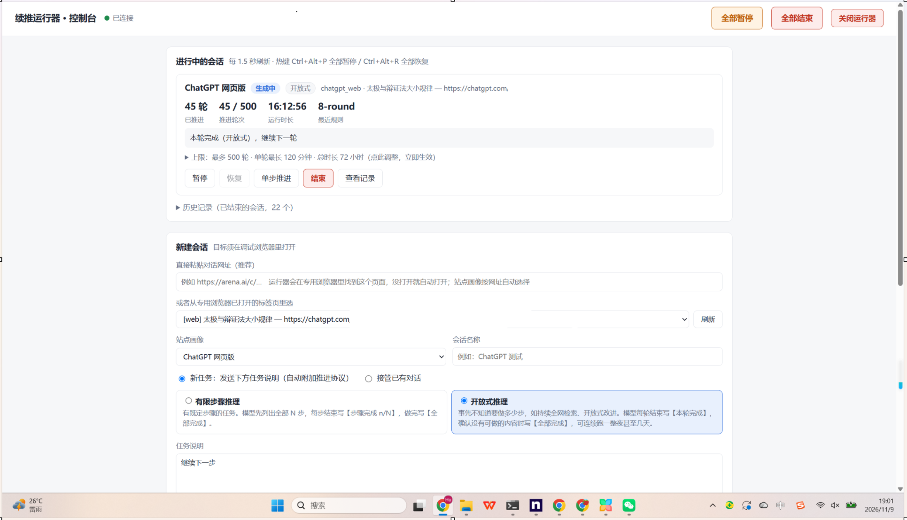
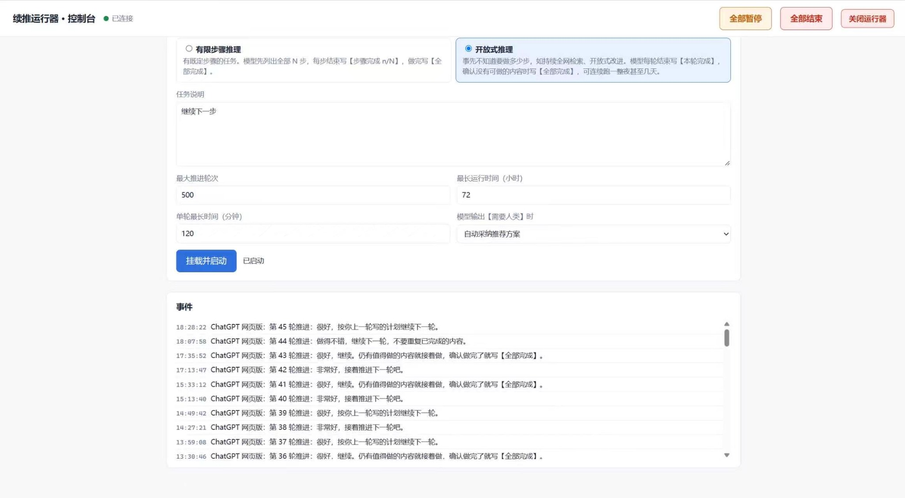

# AutoContinue Runner v0.4.1 — English User Manual

[中文使用手册](README.md) · [Bilingual quick start](QUICKSTART.md) · [MIT License](LICENSE)

AutoContinue Runner monitors a supported AI chat, detects when a response has completed, checks continuation rules and safety conditions, and submits a follow-up message when appropriate. A local dashboard and an optional MCP bridge let human users and authorized AI agents manage long-running sessions. This is a **continuation assistant**, not a guarantee that the model's answer or actions are correct.

## Real-world running screenshots (2026-11-09)

These screenshots were supplied by a user running the software on Windows; they are not conceptual mock-ups. At capture, the dashboard showed **round 45 of a 500-round limit**, with **16:12:56** elapsed, and the event log displayed continuation rounds 36–45. These records show the previous running environment, **not** an independent 18-hour regression test of this bilingual modification.



*Figure 1. Active session, adjustable limits, controls, and history.*



*Figure 2. Real continuation event history.*

Screenshot provenance: [docs/screenshots/README.md](docs/screenshots/README.md).

## 1. Install on Windows 10/11

1. Extract the entire ZIP to a permanent folder, such as `D:\AutoContinueRunner`. **Do not run files from inside the archive.**
2. Double-click **`安装.bat` (Install)**. This downloads a portable Python 3.12 runtime into `runtime/`, installs dependencies, and creates desktop / Start-menu shortcuts. An internet connection is required initially. Existing Python installations are not modified.
3. Double-click the shortcut **续推运行器** or **`启动续推运行器.bat` (Launch)**. A dedicated Chrome/Edge profile is opened, along with the dashboard at `http://127.0.0.1:8765/`.
4. Log in to the AI websites in that **dedicated browser**. Do not enter credentials into the runner itself.
5. In the dashboard, use the **中文 / English** selector in the top-right corner. The selection persists in this browser's local storage.

If moving the installation folder, run `安装.bat` again to fix shortcuts. To uninstall, double-click `卸载.bat` (Uninstall). Login profiles and session history are preserved unless you delete the whole folder.

## 2. Start a session

Paste a conversation URL (recommended), or choose an already open tab in the dedicated browser. The runner automatically selects a matching site profile, which describes how to identify messages and controls for a particular AI website.

Choose **New task** to send your written instructions and the continuation protocol, or **Continue existing conversation** to take over an already active chat. Choose the task type:

| Mode | Use case | Completion markers expected from the model |
| --- | --- | --- |
| Finite-step | A task with a known N-step plan | `【步骤完成 n/N】` at each step; `【全部完成】` at the end |
| Open-ended | Research or improvement without a fixed total | `【本轮完成】` at the end of each round; `【全部完成】` at the end |

The protocol also uses `【需要人类】` to request human intervention. **These exact Chinese markers intentionally remain unchanged even in the English UI**: they are machine-readable control tokens in the current v0.4.1 engine. They are not mistranslations. The initial defaults are 40 rounds / 6 hours for finite-step tasks and 500 rounds / 72 hours for open-ended tasks; adjust them to fit your work.

Set the **maximum rounds**, **total runtime (hours)**, and **maximum time per round (minutes)**. After a round times out, the runner waits as long as generation is still active; a prolonged idle period triggers a pause. Click **Attach and start**.

## 3. Supervise ongoing work

The dashboard shows each session's progress, number of rounds, elapsed time, most recent decision rule, and last reason. Each card supports **Pause**, **Resume**, **Advance one step**, **Stop**, and **View log**. The expandable limits panel lets you change limits while a session is running. Completed sessions appear in **History**, and evidence is stored under `output/`.

Global controls: **Pause all**, **Stop all**, **Shut down runner**. Hotkeys: `Ctrl+Alt+P` pauses all sessions, and `Ctrl+Alt+R` resumes all. If a human sends a message in the monitored conversation, the runner should yield control rather than overwrite it. Draft text in the composer is protected against overwriting.

Typical reasons for automatic pauses include `【需要人类】`, dangerous command patterns, a login/website change, a repeated answer, a technical failure, or a configured limit. A model writing `【全部完成】` is **not evidence that the real-world goal was achieved**: review deliverables and logs.

## 4. How continuation detection works

For supported CDP-controlled websites, the runner can inspect ongoing network-generation signals and, where supported, the underlying conversation data. If these aren't available, it uses visible activity and text stability as a fallback. It waits for a *new* response after every submitted follow-up, reducing duplicate continuations.

It only writes into the matching conversation composer, avoids other editable regions, and pauses if a human draft is present. At most one runner session should own a browser tab. If a website changes its DOM or flow, re-calibration may be needed.

Rules are evaluated in priority order: safety and page abnormalities, task completion, human intervention, backoff for rate limiting, interruption/truncation, repetition, step progression, question handling, and generic continuation. Rule strings can be customized in `runner.yaml`.

## 5. Supported websites and desktop programs

The included profiles are `chatgpt_web`, `claude_web`, `arena_web`, `gemini_web`, and `deepseek_web`. According to the source package's v0.4.1 documentation, ChatGPT (including Work), Claude, and Arena were previously exercised on the developer's machine; Gemini and DeepSeek are supplied as **unverified profiles**. **These historical claims are not an independent certification for the current versions of those websites.** Start with supervised test runs, and verify the profile before unattended use.

For a different website, use web calibration: `runtime\python.exe -m autocontinue calibrate --target <tab-id> --id my_site --name "My site"`. Follow the on-screen prompts to identify the composer, send button, stop button, assistant response, and user message.

Desktop apps have three potential integration modes, ordered by preference:

- **Electron CDP:** start the app with `--remote-debugging-port=9333`, test via `targets --endpoint http://127.0.0.1:9333`, then calibrate that endpoint.
- **Windows UI Automation:** inspect controls using `dump-uia --title <window-title>` and create a matching profile.
- **Visual fallback:** use `calibrate-desktop --title <window-title> --id <profile-id>`, with optional OCR components. This mode can move the mouse, change foreground windows, and use the clipboard, and needs more supervision.

The source package stated that the UIA and visual modes had received static/compile checks but not full Windows end-to-end verification.

## 6. MCP integration for AI clients

**Local stdio:** with the runner running, add to your compatible MCP client's settings (edit the install path):

```json
{
  "mcpServers": {
    "autocontinue": {
      "command": "D:\AutoContinueRunner\runtime\python.exe",
      "args": ["-m", "autocontinue", "mcp"]
    }
  }
}
```

**Local streamable HTTP:** run `启动AI接口.bat` (Start AI Interface). Its default URL is `http://127.0.0.1:8766/mcp`. The bridge requires an `Authorization: Bearer <token>` header; its token is created in `mcp.token`. **Never commit or share this token.** When remote access is needed, use a restricted, authenticated HTTPS tunnel and verify access controls.

MCP tools:

| Tool | Purpose |
| --- | --- |
| `relay_health` | Check readiness |
| `relay_list_targets` | List browser targets and approved profiles |
| `relay_arm` | Start continuation for an explicit HTTPS conversation URL |
| `relay_status` / `relay_wait` | Read status and wait for progress |
| `relay_pause` / `relay_resume` / `relay_disarm` | Pause, resume, or end owned sessions |

An AI MCP client may only see/control the sessions it started. Profiles must be explicitly verified. Sensitive pauses (human review, dangerous operations, human takeover, drafts, and limits) cannot be bypassed by an MCP resume request. MCP resume attempts are audited in `output/mcp_bridge.sqlite3`.

## 7. Local HTTP API

Default dashboard and HTTP API: `http://127.0.0.1:8765` (loopback only). It has no general bearer-token authentication. **Do not expose this port through ngrok, a public reverse proxy, or an untrusted LAN.** Browser cross-origin mutation requests are rejected, but this is not equivalent to network authentication.

| Method | Path | Purpose |
| --- | --- | --- |
| GET | `/health`, `/profiles`, `/targets` | Status and target discovery |
| GET | `/sessions`, `/sessions/{id}`, `/archive` | Live and historical sessions |
| POST | `/sessions` | Create a session |
| POST | `/sessions/{id}/pause`, `/resume`, `/step`, `/stop` | Session controls |
| POST | `/sessions/{id}/limits` | Change live limits |
| GET | `/sessions/{id}/log?tail=20` | Inspect recent log |
| POST | `/pause_all`, `/resume_all`, `/stop_all`, `/shutdown` | Global controls |

Session creation example:

```json
{"url":"https://chatgpt.com/c/example", "task":"Research the topic", "mode":"new", "task_mode":"steps", "name":"Research", "max_rounds":30, "max_runtime_h":6, "max_turn_min":90, "on_need_human":"pause"}
```

## 8. CLI

From the installation folder, use `runtime\python.exe -m autocontinue` followed by:

```text
launch                      Launch browser + runner + dashboard
serve [--open]              Start the API service (optionally open dashboard)
chrome [URL ...]             Open dedicated CDP browser
targets                      List browser targets
profiles                     List site profiles
run --profile chatgpt_web --task "Your task"   Run from CLI
calibrate --target <id> --id my_site           Calibrate a site
mcp [--transport streamable-http --port 8766] Start MCP bridge
```

## 9. Configuration, logs, and privacy

`runner.yaml` configures the CDP endpoint (`9230` by default), browser profile, session history, prompt templates, risk checks, runtime limits, notification webhook, and API/MCP ports. It currently contains Chinese-language continuation phrases. They may be replaced with English phrases, but **keep protocol markers unchanged** unless you also update the detection rules and tests.

Each session's `output/` directory contains `session.json`, `rounds.jsonl`, `transcript.md`, response files, screenshots, and `events.log`. These may include **private chat content, screenshots, or task information** and must never be published. The `chrome-profile/` folder can contain authenticated browser data. `.gitignore` excludes these local folders, tokens, and runtime dependencies.

The installer downloads and SHA-256 checks the official Python embedded runtime, then installs pinned dependencies from Python package indexes (with configured fallbacks). Review external dependencies and downloads before enterprise deployment.

## 10. Important limitations and safety

- Website changes can break selectors or stream detection. A profile marked verified was verified in a specific environment at a specific time, not forever.
- Long-running AI workflows can make costly mistakes. Use least-privilege accounts; do not grant an unsupervised model sensitive shell, financial, publishing, or deletion privileges.
- Dangerous-command keyword checks are heuristic. Add task-specific restrictions and require human approval for irreversible actions.
- A model's completion marker is not external validation. Check the actual task results.
- Windows installer, UI Automation, CDP, MCP bridge, and site end-to-end tests should be run on a real Windows machine before a broad production release.

## 11. Uninstall

Close the runner and double-click `卸载.bat`. This removes shortcuts and the portable Python runtime. Browser data and session logs remain for review; manually delete the installation directory to erase them.

## 12. Contributing and license

The source code is made available under the **MIT License** (see `LICENSE`). Please do not include access tokens, cookie databases, private transcripts, browser profile data, or user screenshots in issues or pull requests. Report security problems privately to the maintainers rather than posting exploit details publicly.
