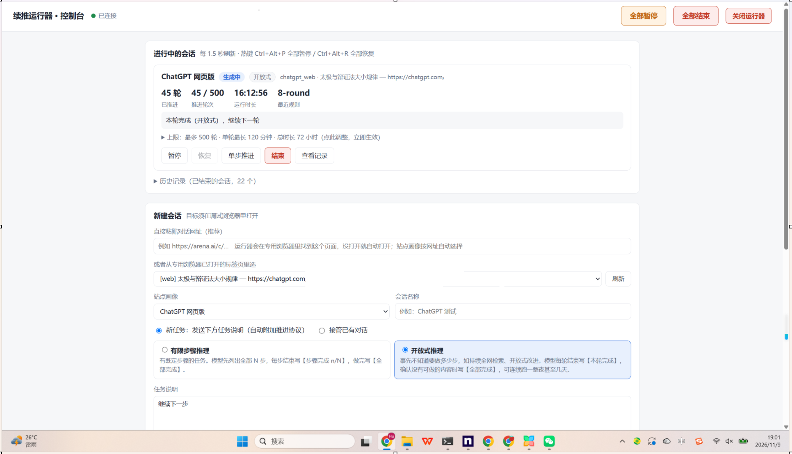
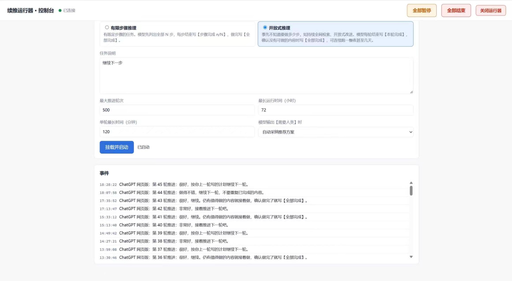

# 续推运行器 AutoContinue Runner v0.4.1 (中文 / English)

**English documentation:** [README.en.md](README.en.md) · **Quick start:** [QUICKSTART.md](QUICKSTART.md) · **License:** [MIT](LICENSE)

**界面语言：** 控制台右上角可切换「中文 / English」，不会改动会话协议中的中文结束标记。

**开源安全提醒：** API 默认仅监听 `127.0.0.1`，切勿把 8765 控制端口直接暴露到互联网；只有 MCP 8766 具备令牌鉴权，也必须使用受保护的 HTTPS 隧道。首次运行前应了解浏览器调试端口和自动行动风险。


守在任意大模型对话窗口旁：感知输出停止 → 判定该不该推 → 注入“非常棒，让我们继续下一步”这类推进词 → 核验已提交，循环直到任务完成、触发熔断或人类接管。人可以在网页控制页上用，云知、莫尔等 AI 智能体也可以经 MCP 接口直接调用。

## 真实运行截图（2026-11-09）

这两张图来自实际 Windows 运行环境，而非概念效果图。截图显示续推会话进行到第 **45 轮 / 500 轮**，当时运行 **16:12:56**；另附第 36–45 轮的推进事件记录。运行截图仅证明当时的操作状态，并不等同于本次双语修改版完成了同样时长的回归测试。



*图 1：实际运行控制台、会话状态、参数调整与历史会话。*



*图 2：续推轮次与事件日志。*

截图说明与来源详见 [docs/screenshots/README.md](docs/screenshots/README.md)。

## 一、安装（Windows 10 / 11）

1. 把压缩包解压到一个固定的位置，例如 `D:\续推运行器`（不要直接在压缩包里运行）。
2. 双击 **`安装.bat`**。它会：
   - 下载一个独立的 Python 3.12 运行环境放进程序目录的 `runtime` 文件夹（约 11MB，官方源不通时自动换国内镜像，并校验文件），不影响电脑上已有的 Python，也不需要你先装 Python；
   - 安装运行所需的组件（约 60MB，PyPI 不通时自动换阿里云、清华镜像）；
   - 在桌面和开始菜单创建“续推运行器”快捷方式。
3. 看到“安装完成”即可。安装可以重复运行，缺什么补什么。

需要联网一次；之后整个文件夹可以整体搬动（搬动后再双击一次 `安装.bat` 重建快捷方式即可）。浏览器用电脑上已有的 Chrome 或 Edge，不需要另装。

**卸载**：双击 `卸载.bat`，删除快捷方式和运行环境；会话记录和专用浏览器的登录信息会保留，不需要的话直接删除整个文件夹。

## 二、日常使用

双击桌面上的 **“续推运行器”**。它会依次：

1. 检查专用浏览器（调试端口 9230）是否在运行，没有就用程序目录下的专用配置 `chrome-profile` 启动 Chrome / Edge 并打开 ChatGPT；
2. 检查运行器是否在运行，没有就在名为 AutoContinue Runner 的窗口里启动；
3. 打开控制页 http://127.0.0.1:8765/ 。

已经在运行的部分不会重复启动，所以可以随时再点一次来找回控制页。

**第一次使用**：在弹出的专用浏览器里登录你要用的大模型网站（ChatGPT、Claude、arena.ai 等）。以后一直用这个浏览器打开对话。

**新建会话**：在控制页“新建会话”里

- **对话网址**：直接粘贴对话网址。专用浏览器里已经开着就用它，没开就自动新开；站点画像按网址自动选。也可以从下拉框选已打开的标签页。
- **新任务 / 接管已有对话**：新任务会先发送你写的任务说明；接管则在现有对话上接着推。
- **任务类型**：有限步骤推理（有既定步骤，模型写【步骤完成 n/N】）或开放式推理（不知道总共几步，模型每轮写【本轮完成】）。
- **上限**：最大轮次、总时长、**单轮最长时间（分钟）**。开发测试类任务一轮可能很久，可以填大一些。

点“挂载并启动”之后就可以离开。

**运行中调整**：每张会话卡片上有“上限”面板，可随时修改最大轮次、单轮最长时间、总时长，保存后立即生效。因为到了上限而暂停的会话，调大后点“恢复”接着跑。

**单轮超时怎么判**：一轮超过“单轮最长时间”后，只要模型还在输出就继续等；连续 10 分钟没有任何新内容才判为卡死并暂停。

**什么时候会停下来叫你**（提示音 + 可选 webhook）：模型输出【需要人类】、出现危险操作关键词、限额用尽、页面跳转或登录失效、连续重复、达到轮次或时长上限。处理完后在控制页点“恢复”；如果你什么都没改就点恢复，视为批准当前回答，直接继续推进。

**随时可以停**：控制页顶部有“全部暂停”“全部结束”“关闭运行器”；每个会话卡片上有暂停、恢复、单步推进、结束；也可以直接关掉 AutoContinue Runner 窗口。全局热键 `Ctrl+Alt+P` 全部暂停，`Ctrl+Alt+R` 全部恢复。在被续推的对话里亲自发一句话，该会话会自动切换为人类接管。

会话结束后卡片自动移出页面、停止计时，只在折叠的“历史记录”里留一行，完整记录在 `output/` 里。

## 三、它怎么判断“该推了”

**停止检测**（v0.2 起以内部信号为准，不看页面渲染）：

- **网络流**：画像里配置了生成接口（如 ChatGPT 的 `POST /backend-api/f/conversation`）时，这个请求在途就是“正在生成”，请求关闭才算输出结束。长文渲染不全、页面没有停止按钮、思考期长时间无输出，都不会影响判断。
- **数据层**：ChatGPT 画像会直接读取会话数据（`/backend-api/conversation/{id}`），确认最新一条是**新的**、状态为 `finished_successfully` 且 `end_turn` 的助手消息才算本轮结束，并用其中的**完整原文**做判定（协议标记写在长文末尾、页面上看不到也能读到）。人类在别处发的消息也能从数据层发现。
- **兜底**：没有网络流 / 数据层的站点，仍用“停止按钮消失 + 回答文本在稳定窗口内不再变化”。
- 注入后必须先观察到新一轮开始（新的生成请求或新的消息 id），才进入下一轮判断，同一条回答不会被判定两次。

**输入位置**：按页面内部结构定位，只认对话输入区（画像里的 `composer_root`）里的输入框，回答里的文档块、代码块等可编辑区一律排除；选中后打上标记，写入和核验都只针对它。输入框里有不是运行器写的内容（人类没发出去的草稿）时不覆盖，直接暂停。只点“发送”，从不点“停止”。

**一个标签页只能有一个续推会话**：重复挂载会被拒绝，避免两个会话抢着推进。

**两种任务类型**（新建会话时选择）：

| 类型 | 适用 | 模型的标记 | 默认上限 |
| --- | --- | --- | --- |
| 有限步骤推理 | 有既定步骤的任务（写书分章、按清单改代码） | 先列出全部 N 步，每步结束写【步骤完成 n/N】 | 40 轮 / 6 小时 |
| 开放式推理 | 事先不知道要做多少步（持续全网检索、开放式改进） | 不列总步数，每轮结束写一两句“本轮做了什么、下一轮做什么”和【本轮完成】 | 500 轮 / 72 小时 |

两种类型都在确认没有可做的内容时写【全部完成】自动结束，需要人拍板时写【需要人类】暂停。上限可在新建时修改。

**推进协议**：新任务时，运行器按所选类型在任务说明末尾附加对应的协议（有限步骤：【步骤完成 n/N】；开放式：【本轮完成】），全部完成写【全部完成】，需要人拍板写【需要人类】。接管已有对话时，协议并入第一句推进词。模型连续两轮忘记写标记，推进词后会自动追加一句提醒。

**判定优先级**（第一条命中的规则决定动作）：

| 优先级 | 条件 | 动作 |
| --- | --- | --- |
| 1 | 危险关键词、页面异常 | 暂停叫人 |
| 2 | 【全部完成】 | 结束，导出记录 |
| 3 | 【需要人类】 | 暂停（可配置为自动采纳推荐方案） |
| 4 | 限额 / 限流 / 繁忙 | 退避 60 / 180 / 600 秒后重试，仍不行则暂停 |
| 5 | 报错或空回答 | 发“从上一步继续” |
| 6 | 回答被截断 | 发“接着写” |
| 7 | 连续多轮高度重复 | 暂停 |
| 8 | 【步骤完成 n/N】 | 发“继续第 n+1 步”；步骤倒退则暂停 |
| 9 | 以提问结尾 | 让模型自行决定后继续（可配置为暂停） |
| 10 | 其他 | 从推进词池轮换一句 |

## 四、站点画像

每个目标一份 `profiles/*.yaml`，程序本身不含任何站点特定逻辑。

| 画像 | 状态 |
| --- | --- |
| `gemini_web` | 按公开页面结构预填，**未在你的电脑上实测** |
| `chatgpt_web` | **已在 AI之家电脑上实测**（2026-11 新版界面）：网络流 + 数据层判定、输入区结构定位；普通对话（“询问 ChatGPT”）与 ChatGPT Work（“使用 ChatGPT Work”）两种输入区都支持 |
| `claude_web` | **已在 AI之家电脑上实测**（2026-11-03，claude.ai）：按内部状态属性 `data-is-streaming` 与停止按钮判断生成，3 步任务自动推完 |
| `arena_web` | **已在 AI之家电脑上实测**（2026-11-05，arena.ai Direct 单模型对话）：生成流 + 发送/停止按钮判断；消息列表最新在前（`newest_first`） |
| `deepseek_web` | 同上；未配置停止按钮，靠网络流 + 文本稳定判断 |
| 其他网站 | 用“校准网页”生成 |

各家页面经常改版，预填选择器失效时运行器会暂停并提示重新校准。建议每个站点先有人看着跑几轮，确认无误后把画像里的 `verified` 改为 `true`。

**校准网页**（控制台“校准网页”按钮，或 `runtime\python.exe -m autocontinue calibrate --target <标签页id前缀> --id my_site --name 我的站点`）：在浏览器里打开该大模型的新对话，按页面顶部提示依次点选输入框、发送按钮、生成中的停止按钮、模型回答、你的消息。单击选中，↑ 扩大到父元素，↓ 缩小，Enter 确认，Esc 跳过。过程中会自动发送一条测试消息。

## 五、桌面应用（如腾讯元宝桌面版）

按以下顺序尝试，能用前面的就不用后面的：

**A 档：调试端口直连（推荐）。** 很多桌面版大模型是 Electron 套壳网页。退出该应用，用 `"应用.exe" --remote-debugging-port=9333` 启动它，然后执行 `runtime\python.exe -m autocontinue targets --endpoint http://127.0.0.1:9333`。能列出页面就说明支持，接着用 `calibrate --endpoint http://127.0.0.1:9333 ...` 校准，之后与网页版用法完全相同，全程不抢焦点。示例见 `profiles/examples/electron_desktop.yaml.example`。

**B 档：UI Automation 控件树。** `runtime\python.exe -m autocontinue dump-uia --title 元宝` 打印控件树，照 `profiles/examples/uia_desktop.yaml.example` 填写输入框、消息区、发送/停止按钮的定位条件。

**C 档：视觉兜底。** `runtime\python.exe -m autocontinue calibrate-desktop --title 元宝 --id yuanbao_vision`，按命令行提示把鼠标移到回答区、输入框、按钮区的左上角和右下角。运行时靠截图指纹判断停止，靠 OCR 读取协议标记（需另装 OCR 组件，见 `requirements-ocr.txt` 里的说明）。这一档会切换前台窗口、移动鼠标并使用剪贴板：用户最近 10 秒有键鼠操作时自动推迟注入，注入后还原前台窗口和剪贴板。建议在独立电脑或不常用的窗口上运行。窗口大小改变后需重新校准。

## 六、让 AI 直接调用（MCP 接口）

人用控制页，AI 用 MCP 接口，两者操作的是同一个运行器。运行器本体需要先在运行（双击“续推运行器”）。

**本机 MCP 客户端（如 Claude 桌面版）**用 stdio 方式，在客户端的 MCP 配置里加入（把路径换成你的安装位置）：

```json
{
  "mcpServers": {
    "autocontinue": {
      "command": "D:\\续推运行器\\runtime\\python.exe",
      "args": ["-m", "autocontinue", "mcp"]
    }
  }
}
```

**经网络通道接入的 AI**（如经动作打印机、天枢远程挂载）：双击 `启动AI接口.bat`，在本机 `http://127.0.0.1:8766/mcp` 提供 streamable-http 接口，请求需带 `Authorization: Bearer <令牌>`，令牌在程序目录的 `mcp.token`（首次自动生成，请勿外传）。需要远程访问时再经你自己的通道（如 ngrok）转发这个端口。

**工具与规则**：

| 工具 | 作用 |
| --- | --- |
| `relay_health` | 运行器是否就绪 |
| `relay_list_targets` | 专用浏览器里已打开的对话页和可用画像 |
| `relay_arm` | 在指定对话网址上启动续推（`mode` new/takeover，`task_mode` steps/open，`max_rounds`、`max_runtime_h`、`max_turn_min`） |
| `relay_status` / `relay_wait` | 查看状态 / 等待进展（只看不发） |
| `relay_pause` / `relay_resume` / `relay_disarm` | 暂停 / 恢复 / 提前结束 |

- AI 只能看到、控制自己经接口启动的会话；人在控制页启动的会话对 AI 不可见。
- 启动时必须给出确切的 https 对话网址，且只能用已实测（`verified: true`）的站点画像。
- `relay_resume` 只能恢复技术性暂停（注入失败、超时、页面异常、重复、步骤倒退、提问）或 AI 自己发起的暂停；【需要人类】、危险关键词、人类接管、人类草稿、轮次与时长上限只能由人在控制页恢复。每次恢复尝试都记入审计（`output/mcp_bridge.sqlite3`）。
- 状态里的 `completion_marker_observed` 只表示模型自报【全部完成】，不等于成果已验收。

**HTTP API**（`http://127.0.0.1:8765`，只监听本机，供其他程序对接）：

| 方法 | 路径 | 说明 |
| --- | --- | --- |
| GET | `/targets`、`/profiles` | 可续推的目标、站点画像 |
| POST | `/sessions` | 启动会话，请求体见下 |
| GET | `/sessions`、`/sessions/{id}`、`/archive` | 进行中的会话、单个会话、历史 |
| POST | `/sessions/{id}/pause\|resume\|step\|stop` | 控制 |
| POST | `/sessions/{id}/limits` | 运行中调整 `max_rounds`、`max_turn_min`、`max_runtime_h` |
| GET | `/sessions/{id}/log?tail=20` | 最近的判定记录与事件 |
| POST | `/pause_all`、`/resume_all`、`/stop_all` | 全局控制 |

```json
{"url": "https://chatgpt.com/c/……", "task": "任务说明", "mode": "new", "task_mode": "steps",
 "name": "书稿第三章", "max_rounds": 30, "max_runtime_h": 6, "max_turn_min": 90, "on_need_human": "pause"}
```

**通知 webhook**：在 `runner.yaml` 的 `notify.webhook` 填写地址，暂停、完成、出错时会 POST 一段 JSON（会话名、原因、进度）。

## 七、命令行

在程序目录打开命令行，用自带的运行环境执行：

```
runtime\python.exe -m autocontinue launch                 一键启动（同桌面快捷方式）
runtime\python.exe -m autocontinue serve [--open]         只启动运行器与控制页
runtime\python.exe -m autocontinue chrome [网址...]        以调试端口启动专用浏览器
runtime\python.exe -m autocontinue targets                列出可续推的标签页 / 窗口
runtime\python.exe -m autocontinue profiles               列出站点画像
runtime\python.exe -m autocontinue run --profile chatgpt_web --task "……" [--max-rounds 30]
runtime\python.exe -m autocontinue calibrate --target <id前缀或网址片段> --id <画像ID> [--name 名称]
runtime\python.exe -m autocontinue mcp [--transport streamable-http --port 8766]
```

## 八、记录与复盘

每个会话在 `output/` 下一个文件夹：

```
output/2026-10-28_093000_chatgpt_web_书稿第三章/
├── session.json     会话元信息与结束原因
├── rounds.jsonl     每轮：命中规则、判定结论、耗时、字数
├── transcript.md    完整对话（任务说明、每轮推进词与回答）
├── replies/001.md   每轮回答原文
├── shots/           暂停、出错、完成时的截图
└── events.log       底层事件（状态变化、注入、重试）
```

## 九、配置

`runner.yaml` 中可调整推进词池、协议文本、各类上限、【需要人类】与提问时的默认行为、危险关键词、通知方式与端口。画像中的 `timing` 可按站点调整稳定窗口、开始生成时限、单轮最长时间等。

内置的危险关键词只拦截命令类操作（`rm -rf`、`format c:`、`DROP TABLE` 等），不拦截“支付”“删除”这类写作中常见的词。如果被续推的模型能直接操作电脑或账户，请在 `runner.yaml` 的 `behaviour.danger_keywords` 里自行补充（如 支付、转账、删除文件）。

## 十、已验证范围

- ChatGPT（含 ChatGPT Work）、Claude、arena.ai 三个站点画像已在真实页面上实测；Gemini、DeepSeek 画像按公开页面结构预填，首次使用请有人看着跑几轮，确认无误后把画像里的 `verified` 改为 `true`。
- 自动化测试用真实浏览器加模拟流式聊天页，覆盖多步推进到完成、开放式推理、人类接管与草稿保护、危险词暂停、长轮次不误停与卡死判定、运行中调整上限、粘贴网址启动、最新在前的消息列表、HTTP API 与 MCP 接口的授权规则等。
- 安装包已在 Windows 电脑上从零安装验证：下载并校验独立运行环境、安装依赖、创建快捷方式、一键启动专用浏览器与运行器、AI 接口的授权规则与 HTTP 令牌校验。
- 桌面 UIA 档与视觉档只做了编译与静态检查，首次使用请有人看着。

## 十一、目录结构

```
安装.bat / 卸载.bat       安装、卸载
启动续推运行器.bat         一键启动（桌面快捷方式指向它）
启动AI接口.bat             本机 HTTP 方式的 MCP 接口
autocontinue/             程序本体（core 状态机与判定、adapters 网页与桌面适配、api、mcp_server、ui 控制页）
profiles/                 站点画像（examples/ 下为桌面档示例）
runner.yaml               全局配置
tools/                    安装脚本、图标
runtime/                  安装后生成：独立的 Python 运行环境
chrome-profile/           使用后生成：专用浏览器的登录信息（请勿外传）
output/                   使用后生成：会话记录
```
